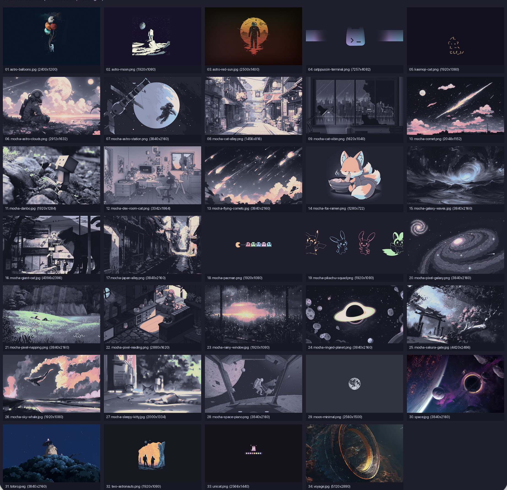

<h2 align="center">akatekhanh's WezTerm Config</h2>

<p align="center">
  <a href="https://github.com/akatekhanh/wezterm-config/stargazers">
    
  </a>
  <a href="https://github.com/akatekhanh/wezterm-config/issues">
    
  </a>
</p>

<p align="center">
  A modular WezTerm configuration with dynamic backgrounds, GPU optimization, and Catppuccin Mocha aesthetics.
</p>


---

## Features

- **Dynamic Background System** - Cycle through 34 Catppuccin Mocha-toned wallpapers (cozy cats, lofi rooms, pixel art, space)
- **Smart GPU Selection** - Auto-selects best GPU/graphics API for WebGpu
- **Platform-Adaptive Keys** - Same shortcuts work across macOS, Windows, Linux
- **Custom Tab Rendering** - Admin/WSL detection, unseen output indicators
- **Focus Mode** - Toggle solid background for distraction-free coding

---

## Backdrops



To add your own, drop an image (jpg, png, gif, ...) into `backdrops/`. WezTerm watches the
folder and reloads on its own when images are added or removed. See
[docs/BACKDROP_GUIDE.md](docs/BACKDROP_GUIDE.md) for sizing and sourcing tips.

---

## Setup

### 1. Install dependencies

**macOS** (Homebrew):

```sh
brew install --cask wezterm font-jetbrains-mono-nerd-font
brew install tmux       # optional: only for the tmux config (step 3)
brew install pngpaste   # optional: only for remote image paste on ALT + i (step 4)
```

**Linux / Windows:** install [WezTerm](https://wezfurlong.org/wezterm/installation.html)
(v20240127+ recommended) and [JetBrainsMono Nerd Font](https://www.nerdfonts.com/font-downloads).

### 2. Install the WezTerm config

```sh
# Back up any existing config. An old single-file ~/.wezterm.lua can shadow this one.
mv ~/.config/wezterm ~/.config/wezterm.bak 2>/dev/null
mv ~/.wezterm.lua ~/.wezterm.lua.bak 2>/dev/null

git clone https://github.com/akatekhanh/wezterm-config.git ~/.config/wezterm
```

Open WezTerm. The config loads on its own and reloads whenever a file changes;
`SUPER + r` reloads it manually. On Windows, clone into `%USERPROFILE%\.config\wezterm`.

### 3. Install the tmux config (optional, macOS)

The `tmux/` folder holds the tmux config used alongside this setup: mouse-wheel scrolling
into copy-mode, a 50k-line scrollback, and a status bar showing session, prefix, zoom,
git branch, current directory, CPU/RAM and time.

```sh
# Back up any existing tmux config
mv ~/.tmux.conf ~/.tmux.conf.bak 2>/dev/null

# Link the config and its status-bar scripts from this repo
ln -s ~/.config/wezterm/tmux/tmux.conf ~/.tmux.conf
mkdir -p ~/.tmux && ln -s ~/.config/wezterm/tmux/scripts ~/.tmux/scripts

# New tmux sessions pick it up automatically. If tmux is already running, reload it:
tmux source-file ~/.tmux.conf
```

Because these are symlinks, a `git pull` in `~/.config/wezterm` updates tmux too.
The status-bar scripts are macOS-only (`sysctl`, `memory_pressure`, `pmset`).

### 4. Remove the author's personal settings

A few settings point at the author's own machines. They don't break anything, but the
matching keys won't work until you change or remove them:

| Setting | Where | What to do |
|---------|-------|------------|
| `SUPER + k`: SSH tab to `khanhpc` | `khanhpc` entry in `config/domains.lua`, `DomainName = 'khanhpc'` binding in `config/bindings.lua` | Point it at your own host, or delete both entries |
| `ALT + i`: paste clipboard image to a remote host | `remote-image-paste` line in `wezterm.lua` (`host = 'macmini'`) | Set `host` to an alias from your `~/.ssh/config`, or delete the line |
| `SUPER_REV + t`: WSL tab | `WSL:Ubuntu` entry in `config/domains.lua` (user `kevin`) | Windows only: set your distro and username |

For fonts, default shell and colors, see [Customization](#customization).

### Troubleshooting

- **Icons show as boxes:** the Nerd Font is missing. Check with
  `wezterm ls-fonts --list-system | grep -i jetbrains`.
- **Config error on startup:** press `F12` to open the debug overlay with the Lua error.
- **tmux status bar has no git/CPU/RAM:** check that `~/.tmux/scripts/*.sh` exist and are
  executable (`chmod +x ~/.tmux/scripts/*.sh`).

---

## Key Bindings

> **SUPER** = `Cmd` (macOS) / `Alt` (Windows/Linux)
> **SUPER_REV** = `Cmd+Ctrl` (macOS) / `Alt+Ctrl` (Windows/Linux)
> **LEADER** = `SUPER_REV + Space`

### Essential

| Keys | Action |
|------|--------|
| `SUPER + t` | New tab |
| `SUPER + w` | Close pane (asks to confirm) |
| `SUPER + \` | Split vertical (new pane below) |
| `SUPER_REV + \` | Split horizontal (new pane to the right) |
| `SUPER + Enter` | Toggle pane zoom |
| `SHIFT + Enter` | Insert a newline instead of submitting (Claude Code, REPLs) |
| `F12` | Debug overlay |
| `SUPER + r` | Reload config (also picks up new/removed backdrops) |

### Navigation

| Keys | Action |
|------|--------|
| `SUPER + [` / `]` | Previous/Next tab |
| `SUPER + 1` … `8` | Jump straight to tab 1-8 |
| `SUPER + 9` | Jump to last tab |
| `SUPER_REV + 9` | Toggle tab bar |
| `SUPER_REV + h/j/k/l` | Move between panes |
| `SUPER + u` / `d` | Scroll up/down |

### Backgrounds

| Keys | Action |
|------|--------|
| `SUPER + /` | Random background |
| `SUPER + ,` / `.` | Cycle backgrounds |
| `SUPER_REV + /` | Fuzzy search backgrounds |
| `SUPER + b` | Toggle focus mode |

### Key Tables

| Keys | Action |
|------|--------|
| `LEADER + f` | Font resize mode (`j/k` to resize, `q` to exit) |
| `LEADER + p` | Pane resize mode (`h/j/k/l` to resize, `q` to exit) |

---

## Customization

| File | Purpose |
|------|---------|
| `config/appearance.lua` | Colors, opacity, GPU settings |
| `config/bindings.lua` | Key bindings |
| `config/fonts.lua` | Font family and size |
| `config/domains.lua` | SSH/WSL domains |
| `config/launch.lua` | Default shell |
| `backdrops/` | Background images |

---

## Structure

```
wezterm.lua           # Entry point
├── config/           # Configuration modules
├── events/           # Event handlers (tab titles, status bar)
├── utils/            # Utilities (backdrops, GPU, platform detection)
├── colors/           # Color schemes (Catppuccin Mocha)
├── backdrops/        # Background images
└── tmux/             # tmux.conf + status-bar scripts
```

---

## Credits

Based on [KevinSilvester/wezterm-config](https://github.com/KevinSilvester/wezterm-config)

**Inspirations:**
- [catppuccin/wezterm](https://github.com/catppuccin/wezterm)
- [WezTerm Show & Tell](https://github.com/wez/wezterm/discussions/628)
